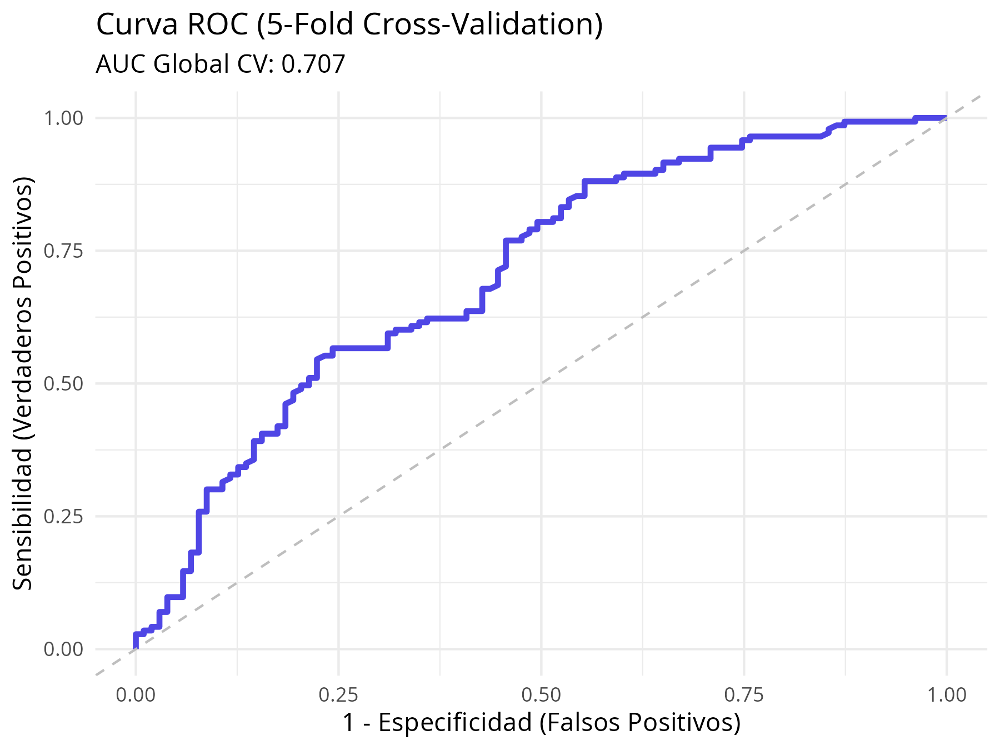

# Project I: Treatment Prediction for Vascular Patients

🇪🇸 [Leer en español](README.es.md)

A decision-support tool for vascular surgeons. Given a patient's age, sex, smoking status and comorbidities, it estimates the probability of a risk outcome (`TTO`) and shows the reasoning behind it. Two models are trained and compared: a **logistic regression** (R) and a **decision tree** (Python / scikit-learn).

## Architecture

Monorepo with two independent parts:

| Part | Stack | Role |
|------|-------|------|
| [`frontend/`](frontend/README.md) | React 19, Vite, Tailwind CSS 4 | Patient form, prediction result, explainability plots |
| [`backend/`](backend/README.md) | FastAPI, scikit-learn, R | REST API, EDA, model training and validation |

```
Proyecto-1/
├── backend/
│   ├── EDA/               # data (raw/processed) and R / Python exploration notebooks
│   └── src/
│       ├── api/           # FastAPI app (POST /predictor)
│       ├── app/           # inference logic
│       └── models/        # training, tuning, validation, saved models
├── frontend/              # React app
├── requirements.txt       # Python dependencies
└── run_server.md          # step-by-step startup guide (Spanish)
```

## Data

- Source: hospital records of patients with abdominal aortic aneurysm (raw file: `backend/EDA/data/raw/dataset_inicial.xlsx`).
- After cleaning: **246 patients**, in `backend/EDA/data/processed/dataset_clean.csv`.
- Features: `Edad` (age), `Sexo` (sex), `Fumador` (0 = never, 1 = active, 2 = former), `comorb_grupos` (comorbidity burden: Bajo / Medio / Alto).
- Target `TTO` is binary: 143 positive vs 103 negative cases.
- Comorbidities (dyslipidemia, diabetes, HTA, IAM, ERC, EPOC, ACV, FA, cancer, ICC, EAP) are grouped by how many the patient has: fewer than 3 → Bajo, 3–5 → Medio, more than 5 → Alto.
- The aneurysm diameter column was dropped because ~80% of its values are missing.

## Models

### 1. Logistic regression (R → JSON → Python)

- Fitted in R (`backend/EDA/notebooks/Exploración de datos.R`) after comparing several candidate models and interactions.
- Final model: `TTO ~ Edad + Sexo + Fumador + comorb_grupos`.
- Coefficients are exported to [`backend/src/models/coeficientes.json`](backend/src/models/coeficientes.json). The API computes `p = 1 / (1 + exp(-z))` from them at request time, so no R runtime is needed to serve predictions.
- The API maps `p` to a risk band: **Bajo** (≤ 0.3), **Medio** (≤ 0.6), **Alto** (> 0.6).

### 2. Decision tree (Python / scikit-learn)

- `DecisionTreeClassifier` trained by `backend/src/models/train_model.py` on an 80/20 split (`random_state=42`).
- Hyperparameters tuned with `GridSearchCV` (5-fold) in `tuning.py` over `max_depth`, `min_samples_split` and `criterion`. The saved model uses `criterion='gini'`, `max_depth=4`.
- Saved to `decision_tree_model.pkl` (joblib). Training also renders the tree to `frontend/public/plots/diagrama_arbol.png` for the UI.

## Results

Both models are evaluated with 5-fold cross-validation on the 246 cleaned patients.

| Model | AUC | Accuracy | F1 (weighted) | Precision (weighted) | Recall (weighted) |
|-------|-----|----------|---------------|----------------------|-------------------|
| Logistic regression | **0.707** | – | – | – | – |
| Decision tree | 0.617 | 0.622 ± 0.054 | 0.604 ± 0.054 | 0.628 ± 0.067 | 0.622 ± 0.054 |

Decision tree, per class (aggregated over folds):

| Class | Precision | Recall | F1 | Support |
|-------|-----------|--------|----|---------|
| `TTO = False` | 0.56 | 0.44 | 0.49 | 103 |
| `TTO = True` | 0.65 | 0.76 | 0.70 | 143 |



**Reading the results**

- The logistic regression separates the classes better (AUC 0.71 vs 0.62) and is easier to explain, so it is the model that powers the API.
- Both models are modest. With ~250 patients and only demographic and comorbidity features, this is a decision-support aid, **not** a replacement for clinical judgement.
- The tree favours the majority class: recall is 0.76 for `True` but only 0.44 for `False`.
- Only AUC was computed for the R model; the other metrics come from `validation.py` and apply to the tree.

## How to run

### Requirements

- Python 3.10+ and Node.js 20+ (the frontend uses Vite 8)
- R (only if you want to re-run the logistic regression analysis)

### Run the app

Start both services in separate terminals. The full step-by-step guide is in [`run_server.md`](run_server.md) (Spanish).

**Backend** (http://127.0.0.1:8000, Swagger docs at `/docs`):

```bash
cd backend
python -m venv .venv && source .venv/bin/activate
pip install -r ../requirements.txt -r src/api/requirements.txt
export PYTHONPATH=$PYTHONPATH:.
fastapi dev src/api/main.py
```

**Frontend** (http://localhost:5173):

```bash
cd frontend
npm install
npm run dev
```

Example request:

```bash
curl -X POST http://127.0.0.1:8000/predictor -H "Content-Type: application/json" -d '{
  "edad": 72, "sexo": true, "fumador": "Ex-fumador",
  "dislipemia": true, "diabetes": false, "hta": true, "iam": false, "erc": false,
  "epoc": false, "acv": false, "fa": false, "cancer": false, "icc": false, "eap": false
}'
# → {"riesgo": "...", "probabilidad": ..., "nota": "..."}
```

### Validate the decision tree

From `backend/` (with the venv active):

```bash
python src/models/validation.py
```

This prints the cross-validated metrics and shows the confusion matrix.

### Retrain the decision tree

```bash
cd backend
python src/models/train_model.py
```

> Note: `train_model.py` reads the data relative to `backend/` but writes the model and plot relative to the repository root, so after retraining you may need to move `decision_tree_model.pkl` and `diagrama_arbol.png` into `backend/src/models/` and `frontend/public/plots/`.
> The committed `.pkl` was saved with scikit-learn 1.8.0; loading it with a different version prints a warning.

### Re-run the logistic regression

Open `backend/EDA/notebooks/Exploración de datos.R` (or the `.Rmd`) in R / RStudio. It rewrites `dataset_clean.csv`, regenerates the ROC curve, and the fitted coefficients should be copied into `coeficientes.json`.

## Further reading

- [`run_server.md`](run_server.md): startup guide
- [`backend/README.md`](backend/README.md): backend structure and inference logic
- [`backend/src/models/README.md`](backend/src/models/README.md): modelling details
- [`backend/EDA/data/README.md`](backend/EDA/data/README.md): data folder
- [`frontend/README.md`](frontend/README.md): frontend
